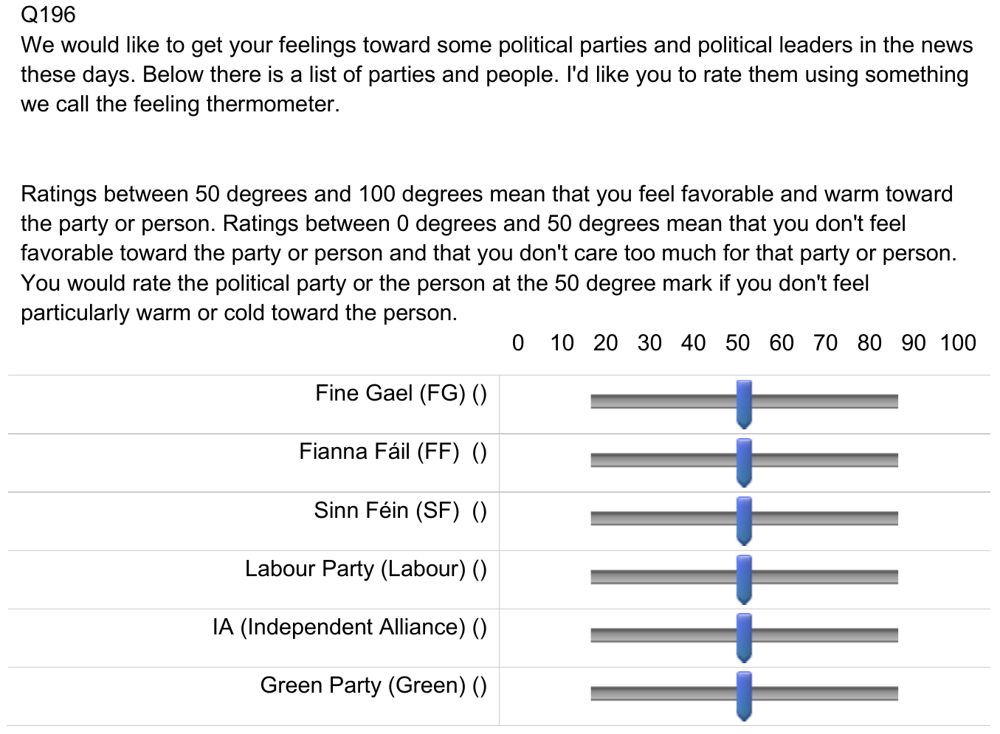
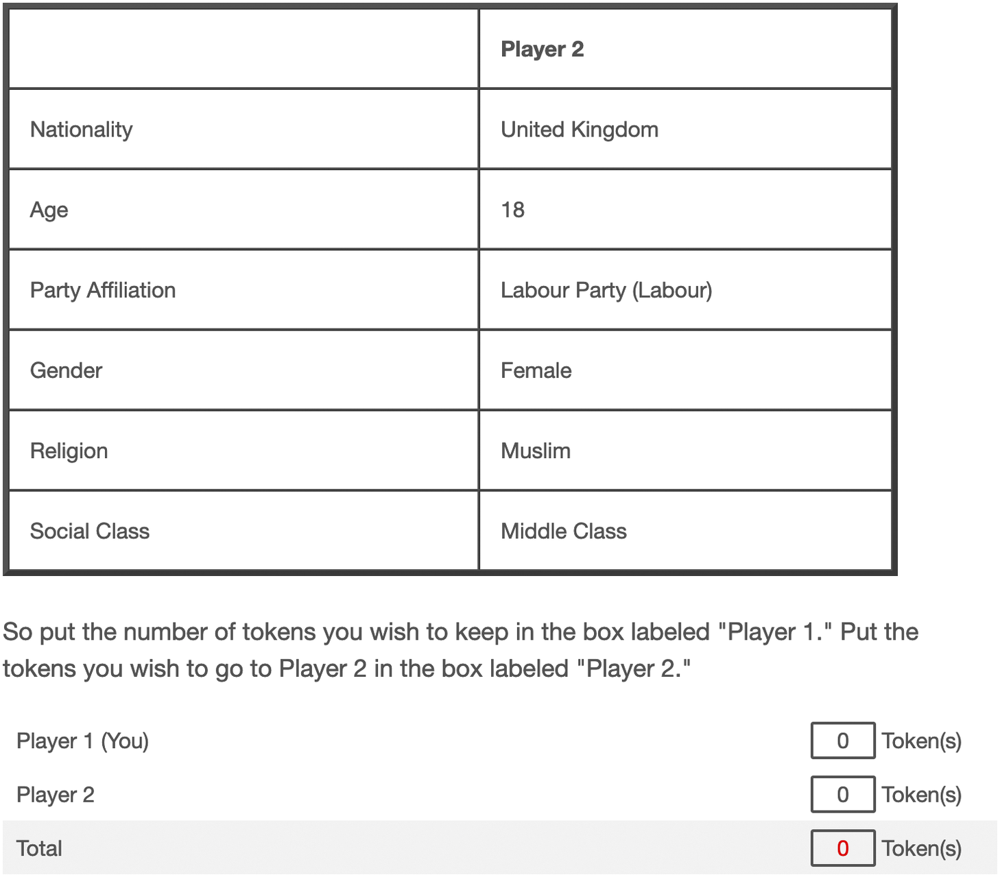

```{r}
#| label: setup
#| include: false

library(ggplot2)
library(dplyr)
library(patchwork)
library(here)

navy <- "#003056"
accent <- "#DE7E50"
grey1 <- "#B9C2CA"
grey2 <- "#7F94A5"

# Partisan types, as in the composition trees (code/00_helper/pid_tree.R)
col_expl <- "#08306b"
col_impl <- "#a63603"

theme_schematic <- function(base = 13) {
  theme_void(base_size = base) +
    theme(
      plot.title = element_text(
        colour = navy,
        face = "bold",
        hjust = 0.5,
        size = rel(1.05),
        margin = margin(b = 3)
      ),
      plot.subtitle = element_text(
        colour = grey2,
        hjust = 0.5,
        size = rel(0.85),
        margin = margin(b = 5)
      ),
      plot.background = element_rect(fill = "white", colour = NA),
      legend.position = "none",
      plot.margin = margin(4, 6, 4, 6)
    )
}
```

## Wer sich bekennt, urteilt härter – [handelt aber nicht anders]{.struck} [handelt aber nur ein bisschen anders]{.fix} {.title-slide-hms}

[Die Rolle subjektiver Parteibindung bei einstellungs- und verhaltensbezogener affektiver Polarisierung in 25 europäischen Demokratien]{style="font-size: 0.55em;"}

{height="400px"}

[ <a href="https://github.com/dertristan" target="_blank" style="text-decoration: none; margin-left: 10px;"> <svg xmlns="http://www.w3.org/2000/svg" width="20" height="20" fill="currentColor" class="bi bi-github" viewBox="0 0 16 16"> <path d="M8 0C3.58 0 0 3.58 0 8c0 3.54 2.29 6.53 5.47 7.59.4.07.55-.17.55-.38 0-.19-.01-.82-.01-1.49-2.01.37-2.53-.49-2.69-.94-.09-.23-.48-.94-.82-1.13-.28-.15-.68-.52-.01-.53.63-.01 1.08.58 1.23.82.72 1.21 1.87.87 2.33.66.07-.52.28-.87.51-1.07-1.78-.2-3.64-.89-3.64-3.95 0-.87.31-1.59.82-2.15-.08-.2-.36-1.02.08-2.12 0 0 .67-.21 2.2.82.64-.18 1.32-.27 2-.27s1.36.09 2 .27c1.53-1.04 2.2-.82 2.2-.82.44 1.1.16 1.92.08 2.12.51.56.82 1.27.82 2.15 0 3.07-1.87 3.75-3.65 3.95.29.25.54.73.54 1.48 0 1.07-.01 1.93-.01 2.2 0 .21.15.46.55.38A8.01 8.01 0 0 0 16 8c0-4.42-3.58-8-8-8"/> </svg> </a> <a href="mailto:tristan.muno@uni-mannheim.de" style="text-decoration: none; margin-left: 5px;"> <svg xmlns="http://www.w3.org/2000/svg" width="20" height="20" fill="currentColor" class="bi bi-envelope" viewBox="0 0 16 16"> <path d="M0 4a2 2 0 0 1 2-2h12a2 2 0 0 1 2 2v8a2 2 0 0 1-2 2H2a2 2 0 0 1-2-2zm2-1a1 1 0 0 0-1 1v.217l7 4.2 7-4.2V4a1 1 0 0 0-1-1zm13 2.383-4.708 2.825L15 11.105zm-.034 6.876-5.64-3.471L8 9.583l-1.326-.795-5.64 3.47A1 1 0 0 0 2 13h12a1 1 0 0 0 .966-.741M1 11.105l4.708-2.897L1 5.383z"/> </svg> </a>]{style="font-size: 0.45em;"}

::: {.notes}

:::

## Agenda

1. Polarisierung als Familie, nicht als Sache
2. Affektive Polarisierung
3. Empirische Einblicke
4. Schlussfolgerungen aus der Anaylse
5. Konsequenzen für die Polarisierungsdebatte

# Polarisierung als Familie, nicht als Sache

## Ein gegenwärtiges Trendwort...

*Polarisierung*, *Polarisation*, *polarisieren*: Die Begriffsfamilie ist im -- nicht nur deutschen -- Sprachgebrauch allgegenwärtig

::: {.columns}
::: {.column width="50%"}
::: {.paper-fig}
![Merriam-Webster: Wort des Jahres 2024 [@merriamwebster2024polarization]](./images/merriam-webster.png)
:::
:::

::: {.column width="50%"}
::: {.paper-fig}
![„polaris\*“ im DWDS-Zeitungskorpus [@dwds2026polaris]](./images/polaris-verlaufskurve.png)
:::
:::
:::

## ... mit langer Geschichte ... {.smaller}

::: {.columns}
::: {.column width="60%"}

- **Antike:** Griechisch *polos*, lateinisch *polus*: die Achse, um die sich etwas dreht [@etymonline2026pole]
  - Drehpunkt, Himmelsachse, geographische Pole
  - Das Adjektiv *polar* kommt erst später über das Mittellateinische [@etymonline2026polar]
- **19. Jh., Physik:** Polarisation als Orientierung/Ausrichtung [@etymonline2026polarize]
  - Optik: Lichtwellen werden in einer Ebene ausgerichtet (Begriff und Verb @malus1811memoire)
  - Elektromagnetismus: Ladungen bzw. Pole werden gegensätzlich angeordnet
- **Ab 1945 vermehrt Soziologie/Psychologie:** Übertragung auf soziale und politische Gruppen als Bestehen bzw. Verstärkung von Unterschieden [@etymonline2026polarize]
  - Hier kommen Spaltung und Konflikt als Wertung hinzu
:::

::: {.column width="40%"}

```{r}
#| label: schematic-physics
#| fig-width: 4.2
#| fig-height: 5.4
#| fig-align: center
#| out-width: "100%"

ang <- seq(0, 165, by = 15) * pi / 180
pre <- do.call(
  rbind,
  lapply(c(0.55, 1.10), function(cx) {
    data.frame(x = cx, dx = 0.17 * cos(ang), dy = 0.52 * sin(ang))
  })
)
post <- data.frame(x = c(2.35, 2.80, 3.25))
grating <- data.frame(gx = seq(1.79, 1.96, length.out = 5))

p_light <- ggplot() +
  geom_segment(
    aes(x = 0.15, xend = 3.45, y = 0, yend = 0),
    colour = grey1,
    linewidth = 0.35,
    linetype = "22"
  ) +
  geom_segment(
    data = pre,
    aes(x = x - dx, xend = x + dx, y = -dy, yend = dy),
    colour = grey1,
    linewidth = 0.7
  ) +
  geom_rect(
    aes(xmin = 1.75, xmax = 2.00, ymin = -0.88, ymax = 0.88),
    fill = "white",
    colour = navy,
    linewidth = 0.9
  ) +
  geom_segment(
    data = grating,
    aes(x = gx, xend = gx, y = -0.82, yend = 0.82),
    colour = navy,
    linewidth = 0.4
  ) +
  geom_segment(
    data = post,
    aes(x = x, xend = x, y = -0.52, yend = 0.52),
    colour = navy,
    linewidth = 1.2
  ) +
  annotate(
    "text",
    x = 0.83,
    y = -1.12,
    label = "unpolarisiert",
    colour = grey2,
    size = 3.2
  ) +
  annotate(
    "text",
    x = 1.88,
    y = 1.12,
    label = "Filter",
    colour = navy,
    size = 3.2
  ) +
  annotate(
    "text",
    x = 2.80,
    y = -1.12,
    label = "polarisiert",
    colour = navy,
    size = 3.2
  ) +
  coord_fixed(xlim = c(0.1, 3.5), ylim = c(-1.35, 1.35)) +
  labs(title = "Licht: in einer Ebene ausgerichtet", subtitle = " ") +
  theme_schematic()

fline <- data.frame(x = -0.78, y = 0.30, xend = 0.78, yend = 0.30)
flineb <- data.frame(x = -0.78, y = -0.30, xend = 0.78, yend = -0.30)
curv <- c(-0.45, -0.80, -1.15)

p_mag <- ggplot() +
  lapply(curv, function(cc) {
    geom_curve(
      data = fline,
      aes(x = x, y = y, xend = xend, yend = yend),
      curvature = cc,
      colour = grey1,
      linewidth = 0.5
    )
  }) +
  lapply(curv, function(cc) {
    geom_curve(
      data = flineb,
      aes(x = x, y = y, xend = xend, yend = yend),
      curvature = -cc,
      colour = grey1,
      linewidth = 0.5
    )
  }) +
  geom_rect(
    aes(xmin = -0.90, xmax = 0, ymin = -0.30, ymax = 0.30),
    fill = navy,
    colour = NA
  ) +
  geom_rect(
    aes(xmin = 0, xmax = 0.90, ymin = -0.30, ymax = 0.30),
    fill = accent,
    colour = NA
  ) +
  annotate(
    "text",
    x = -0.45,
    y = 0,
    label = "N",
    colour = "white",
    fontface = "bold",
    size = 4.6
  ) +
  annotate(
    "text",
    x = 0.45,
    y = 0,
    label = "S",
    colour = "white",
    fontface = "bold",
    size = 4.6
  ) +
  coord_fixed(xlim = c(-1.35, 1.35), ylim = c(-1.35, 1.35)) +
  labs(title = "Magnet: zwei Pole", subtitle = " ") +
  theme_schematic()

p_light / p_mag
```

:::
:::

::: {.notes}

:::

------------------------------------------------------------------------

## ... und mindestens vier Gesichtern ... {.smaller}

::: {style="max-width: 78%;"}
- Mindestens vier mathematisch verschiedene Konzepte -- die sich **in denselben Daten gegenläufig** verhalten können
:::

```{r}
#| label: schematic-four-dists
#| fig-width: 8
#| fig-height: 3.3
#| fig-align: center
#| out-width: "68%"

xs <- seq(-5.5, 5.5, length.out = 400)

base_p <- function(d, title, sub) {
  ggplot(d, aes(x, y, colour = g, group = grp)) +
    geom_hline(yintercept = 0, colour = grey1, linewidth = 0.3) +
    geom_line(linewidth = 0.9) +
    scale_colour_manual(values = c(before = grey1, after = navy)) +
    labs(title = title, subtitle = sub) +
    theme_schematic()
}

d_disp <- rbind(
  data.frame(x = xs, y = dnorm(xs, 0, 1.0), g = "before", grp = "1"),
  data.frame(x = xs, y = dnorm(xs, 0, 2.3), g = "after", grp = "2")
)

d_bim <- rbind(
  data.frame(x = xs, y = dnorm(xs, 0, 1.6), g = "before", grp = "1"),
  data.frame(
    x = xs,
    y = 0.5 * dnorm(xs, -2.1, 0.8) + 0.5 * dnorm(xs, 2.1, 0.8),
    g = "after",
    grp = "2"
  )
)

d_dist <- rbind(
  data.frame(x = xs, y = dnorm(xs, -0.7, 0.9), g = "before", grp = "1"),
  data.frame(x = xs, y = dnorm(xs, 0.7, 0.9), g = "before", grp = "2"),
  data.frame(x = xs, y = dnorm(xs, -2.4, 0.9), g = "after", grp = "3"),
  data.frame(x = xs, y = dnorm(xs, 2.4, 0.9), g = "after", grp = "4")
)

set.seed(7)
n <- 110
aa <- rnorm(n)
d_sort <- rbind(
  data.frame(x = aa, y = rnorm(n), g = "before"),
  data.frame(x = aa, y = 0.9 * aa + sqrt(1 - 0.81) * rnorm(n), g = "after")
)

p_sort <- ggplot(d_sort, aes(x, y, colour = g)) +
  geom_point(size = 0.75, alpha = 0.8) +
  scale_colour_manual(values = c(before = grey1, after = navy)) +
  labs(title = "Sortierung", subtitle = "Konfliktlinien fallen zusammen") +
  theme_schematic()

(base_p(d_disp, "Streuung", "wie weit Meinungen auseinanderliegen") |
  base_p(d_bim, "Bimodalität", "leert sich die Mitte?")) /
  (p_sort |
    base_p(d_dist, "Distanz", "wie weit Gruppen auseinanderliegen"))
```

::: {.notes}

:::

------------------------------------------------------------------------

## ... und drei offenen Fragen

- Zwei Lager (bipolar) oder viele (multipolar)?
- Zustand oder Dynamik/Prozess?
- Wer ist polarisiert (Population) -- und gegen wen/was (Ziel)?

## Quer dazu: Wahrnehmung und Wirklichkeit

- Jedes dieser Konzepte gibt es **zweimal**: wie es ist -- und wie es wahrgenommen wird
- Menschen überschätzen systematisch, wie extrem und wie anders „die anderen“ sind [@levendusky2016mis; @ahler2018parties]
- Wahrgenommene Polarisierung kann wachsen, während die tatsächliche gleich bleibt

```{r}
#| label: schematic-perception
#| fig-width: 8
#| fig-height: 2.6
#| fig-align: center
#| out-width: "66%"

xs <- seq(-5.5, 5.5, length.out = 400)
d_real <- rbind(
  data.frame(x = xs, y = dnorm(xs, -0.9, 1.1), grp = "a"),
  data.frame(x = xs, y = dnorm(xs, 0.9, 1.1), grp = "b")
)
d_perc <- rbind(
  data.frame(x = xs, y = dnorm(xs, -2.6, 0.8), grp = "a"),
  data.frame(x = xs, y = dnorm(xs, 2.6, 0.8), grp = "b")
)

ggplot() +
  geom_hline(yintercept = 0, colour = grey1, linewidth = 0.3) +
  geom_line(
    data = d_real,
    aes(x, y, group = grp),
    colour = grey2,
    linewidth = 1
  ) +
  geom_line(
    data = d_perc,
    aes(x, y, group = grp),
    colour = accent,
    linewidth = 1,
    linetype = "22"
  ) +
  annotate(
    "text",
    x = 0,
    y = 0.42,
    label = "Wirklichkeit",
    colour = grey2,
    fontface = "bold",
    size = 3.6
  ) +
  annotate(
    "text",
    x = -4.4,
    y = 0.50,
    label = "Wahrnehmung",
    colour = accent,
    fontface = "bold",
    size = 3.6
  ) +
  annotate(
    "text",
    x = 4.4,
    y = 0.50,
    label = "Wahrnehmung",
    colour = accent,
    fontface = "bold",
    size = 3.6
  ) +
  coord_cartesian(ylim = c(0, 0.56)) +
  theme_schematic()
```

::: {.notes}

:::

# Affektive Polarisierung

## Nicht *was* wir denken, sondern *wie wir fühlen*

- Statt Streit um ideologische Polarisierung [@fiorina2008polarization; @abramowitz2008ispolarization]: die „affektive Wende" – wie fühlen Anhänger *übereinander*? [@iyengar2012affect]
- Kerngedanke: Parteianhängerschaft als **soziale Identität** -- ein „Wir" und ein „Die anderen"
- Minimaldefinition: Sympathie für die **eigene** Seite, Ablehnung der **anderen**
- Die Abneigung kann weit über sachliche Meinungsunterschiede hinausgehen

::: {.notes}
:::

------------------------------------------------------------------------

## Auch hier: zwei Achsen, vier Zellen {.smaller}

Wem gilt die Abneigung -- und wie wird sie gemessen? [vgl. @druckman2019we; @areal2024verticalvshorizontal]

```{r}
#| label: schematic-ap-typology
#| fig-width: 8
#| fig-height: 3.4
#| fig-align: center
#| out-width: "62%"

cells <- data.frame(
  x = c(1, 2, 1, 2),
  y = c(2, 2, 1, 1),
  lab = c(
    "Gefühlsthermometer\nSympathie für Parteien\n(die übliche Messung)",
    "Wahlentscheidungen\nSpenden, Kandidatenwahl",
    "Soziale Distanz\n„Hätten Sie etwas dagegen,\nwenn Ihr Kind … heiratet?“",
    "Verteilungsspiele\nDiktator- & Vertrauensspiel\nmit Mitbürgern"
  ),
  fill = c(navy, "white", "white", accent),
  txt = c("white", navy, navy, "white")
)

ggplot(cells, aes(x, y)) +
  geom_tile(
    aes(fill = fill),
    colour = navy,
    linewidth = 0.9,
    width = 0.94,
    height = 0.90
  ) +
  geom_text(aes(label = lab, colour = txt), size = 3.0, lineheight = 0.95) +
  scale_fill_identity() +
  scale_colour_identity() +
  annotate(
    "text",
    x = 1,
    y = 2.66,
    label = "Einstellung\nwas Menschen sagen",
    colour = navy,
    fontface = "bold",
    size = 3.2,
    lineheight = 0.95
  ) +
  annotate(
    "text",
    x = 2,
    y = 2.66,
    label = "Verhalten\nwas Menschen tun",
    colour = navy,
    fontface = "bold",
    size = 3.2,
    lineheight = 0.95
  ) +
  annotate(
    "text",
    x = 0.40,
    y = 2,
    angle = 90,
    lineheight = 0.95,
    label = "Vertikal\nParteien & Politiker",
    colour = navy,
    fontface = "bold",
    size = 3.2
  ) +
  annotate(
    "text",
    x = 0.40,
    y = 1,
    angle = 90,
    lineheight = 0.95,
    label = "Horizontal\nMitbürger",
    colour = navy,
    fontface = "bold",
    size = 3.2
  ) +
  annotate(
    "text",
    x = 1.5,
    y = 0.36,
    size = 2.9,
    colour = grey2,
    label = "Diese Studie: die beiden farbigen Zellen – bei denselben Befragten"
  ) +
  coord_cartesian(xlim = c(0.25, 2.62), ylim = c(0.25, 3.02)) +
  theme_schematic()
```

::: {.notes}
:::

------------------------------------------------------------------------

## Und was zählt als „eigene" Partei? {.smaller}

- Um affektive Polarisierung zu berechnen, braucht man eine „eigene" Partei -- wer legt fest, welche das ist?
  - **Bindung:** die Partei, der man sich nahe fühlt
  - **Wahlentscheidung:** die Partei, die man gewählt hat
  - **Höchste Bewertung:** die Partei, die man am besten bewertet
- Schon vor jeder Schätzung stehen konzeptuelle Entscheidungen
- Und sie bestimmen die Grundgesamtheit, auf die sich die Schätzung bezieht (*population of inference*)

# Empirie

------------------------------------------------------------------------

## Wie viele sind es? {.smaller}

```{r}
#| label: composition-data
#| cache: true
#| include: false

source(here("code", "00_helper", "pid_tree.R"))

raw <- readr::read_rds(here("data", "01_raw", "eu25games2019.rds"))
partisan <- readr::read_rds(here("data", "02_processed", "eu25_partisan.rds"))

# Composition sample as in notebook 3.1 (Sample and Duplicates)
comp <- raw |>
  filter(der_att_check_3, meta_wave %in% c(2, 3), !is.na(meta_pid)) |>
  add_count(meta_wave, meta_pid, name = "n_rows") |>
  filter(n_rows == 1 | meta_finished) |>
  add_count(meta_wave, meta_pid, name = "n_left")

dups <- unique(comp$meta_pid[comp$n_left > 1])

comp <- comp |>
  filter(!meta_pid %in% dups) |>
  select(meta_responseid) |>
  inner_join(select(partisan, -wave), by = "meta_responseid")

# Leaves of the tree, as in fig-composition-w23
leaf_shares <- tree_leaves(comp) |>
  count(country, leaf) |>
  mutate(share = n / sum(n), .by = country)

pooled <- leaf_shares |>
  summarise(n = sum(n), .by = leaf) |>
  mutate(share = n / sum(n))

rm(raw)
```

```{r}
#| label: schematic-composition
#| fig-width: 9
#| fig-height: 5
#| fig-align: center
#| out-width: "82%"

laender <- c(
  AT = "Österreich",
  BE = "Belgien",
  BG = "Bulgarien",
  CY = "Zypern",
  CZ = "Tschechien",
  DE = "Deutschland",
  DK = "Dänemark",
  EE = "Estland",
  ES = "Spanien",
  FI = "Finnland",
  FR = "Frankreich",
  GR = "Griechenland",
  EL = "Griechenland",
  HR = "Kroatien",
  HU = "Ungarn",
  IE = "Irland",
  IT = "Italien",
  LT = "Litauen",
  LU = "Luxemburg",
  LV = "Lettland",
  MT = "Malta",
  NL = "Niederlande",
  PL = "Polen",
  PT = "Portugal",
  RO = "Rumänien",
  SE = "Schweden",
  SI = "Slowenien",
  SK = "Slowakei",
  UK = "Vereinigtes Königreich",
  GB = "Vereinigtes Königreich"
)

# German legend labels for the leaves of pid_tree.R
leaf_de <- c(
  "Attached: same party" = "Bindung: gleiche Partei gewählt (explizit)",
  "Attached: different party" = "Bindung: andere Partei gewählt",
  "Attached: vote not matchable" = "Bindung: Wahl nicht zuordenbar",
  "Attached: no vote" = "Bindung: keine Wahl angegeben",
  "No attachment: vote" = "Keine Bindung, aber Wahl (implizit)",
  "No attachment: no vote" = "Keine Bindung, keine Wahl",
  "Attachment DK / missing" = "Bindung: weiß nicht / fehlt",
  "Vote item not fielded" = "Wahlfrage nicht gestellt"
)

# Pooled share of every leaf for the caption, in stacking order
pooled_txt <- pooled |>
  filter(leaf %in% names(leaf_de)) |>
  arrange(match(leaf, names(leaf_de))) |>
  mutate(
    lab = sub("\\s*\\((explizit|implizit)\\)", "", leaf_de[as.character(leaf)]),
    lab = if_else(
      leaf == "Attached: same party",
      "explizit",
      if_else(leaf == "No attachment: vote", "implizit", lab)
    )
  ) |>
  with(paste0(scales::percent(share, 1), " ", lab, collapse = ", "))

d_comp <- leaf_shares |>
  mutate(
    land = coalesce(unname(laender[country]), country),
    attached = sum(share[startsWith(as.character(leaf), "Attached")]),
    .by = country
  ) |>
  mutate(land = reorder(land, attached))

# Labels on every segment, dark text on light fills; segments under 3% get
# the bare number in smaller type so it fits
dark_fills <- c(
  "Attached: same party",
  "Attached: different party",
  "No attachment: vote",
  "Attachment DK / missing"
)
seg_pos <- d_comp |>
  arrange(land, leaf) |>
  mutate(end = cumsum(share), start = end - share, .by = land) |>
  mutate(
    txt = if_else(leaf %in% dark_fills, "white", navy),
    narrow = round(share, 2) < 0.03,
    lab = if_else(
      narrow,
      as.character(round(100 * share)),
      scales::percent(share, 1)
    )
  )

ggplot(d_comp, aes(x = share, y = land, fill = leaf)) +
  geom_col(
    width = 0.8,
    colour = "white",
    linewidth = 0.2,
    position = position_stack(reverse = TRUE)
  ) +
  geom_text(
    data = filter(seg_pos, !narrow),
    aes(x = (start + end) / 2, label = lab, colour = txt),
    size = 2.3
  ) +
  geom_text(
    data = filter(seg_pos, narrow),
    aes(x = (start + end) / 2, label = lab, colour = txt),
    size = 1.8
  ) +
  scale_colour_identity() +
  scale_fill_manual(values = leaf_colours, labels = leaf_de, drop = TRUE) +
  guides(fill = guide_legend(nrow = 2)) +
  scale_x_continuous(
    labels = scales::percent,
    breaks = seq(0, 1, 0.25),
    expand = c(0, 0)
  ) +
  labs(x = NULL, y = NULL, fill = NULL) +
  theme_minimal(base_size = 10) +
  theme(
    legend.position = "bottom",
    panel.grid.major.y = element_blank(),
    panel.grid.minor = element_blank(),
    axis.text.y = element_text(size = 7.5, colour = navy),
    legend.text = element_text(colour = navy),
    plot.margin = margin(22, 12, 2, 2)
  )
```

[Daten: eu25games2019 [@muno2026eu25games], basierend auf @hahm2024divided, Wellen 2 und 3, nur Befragte mit bestandenem Aufmerksamkeitstest, ungewichtet. Insgesamt: `r pooled_txt`.]{style="font-size: 0.45em; color: #7F94A5;"}

::: {.notes}
Wie viele sind das? Hier für alle 25 Länder: Blautöne sind Menschen mit Parteibindung, Orangetöne Menschen ohne. Dunkelblau sind die Expliziten, Dunkelrot die Impliziten.

Zwei Dinge. Erstens: Die Impliziten sind keine Randgruppe. Über alle Länder hinweg ist es etwa jeder Vierte bis Fünfte. Zweitens: Der Anteil schwankt stark zwischen Ländern.

Das heißt: Wer nur die Expliziten untersucht, ändert, über wen er eigentlich Aussagen macht – und zwar in jedem Land unterschiedlich stark. Das ist eine Messentscheidung, die meistens stillschweigend getroffen wird.
:::

------------------------------------------------------------------------

## Der Vergleich: gleiche Partei, anderes Bekenntnis

- Vergleich zwischen expliziten und impliziten Anhängern **derselben Partei im selben Land**
- Für zwei Maße: vertikale Gefühlsthermometer und horizontale Verhaltensspiele
- Limitationen:
  - Ein Zeitausschnitt (d. h. lediglich Aussage über Polarisation als Zustand)
  - Messart (Einstellung/Verhalten) und Ziel (Partei/Person) nicht getrennt identifizierbar

::: {.notes}

:::

------------------------------------------------------------------------

## Messung: Einstellung und Verhalten {.smaller}

::: {style="margin-top: 0.9em;"}
::: {.columns}
::: {.column width="50%"}
**Einstellung: Gefühlsthermometer**

{height="230px" fig-align="center"}

- 0–100 „Grad“ für jede **Partei** (vertikal), 50 neutral
:::

::: {.column width="50%"}
**Verhalten: Diktator- und Vertrauensspiel**

{height="230px" fig-align="center"}

- 10 Punkte an eine **andere Person** (horizontal), Partei ist eines von sechs Merkmalen, je 3 Runden [@hahm2024divided]
:::
:::
:::

Für Messung $m \in \{\text{Thermometer}, \text{Spiele}\}$ und Typ $t \in \{\text{explizit}, \text{implizit}\}$, in SD-Einheiten von $Y^m$:

$$
AP^m_t = E(Y^m \mid R = \text{eigen}, T = t) - E(Y^m \mid R = \text{fremd}, T = t), \qquad
\Delta AP^m = AP^m_{\text{explizit}} - AP^m_{\text{implizit}}
$$

::: {.notes}
:::

------------------------------------------------------------------------

## Ergebnis: alle Länder zusammen {.smaller}

```{r}
#| label: results-load
#| include: false

library(ggdist)

post <- readr::read_rds(here("data", "05_results", "eu25_ap_post.rds"))

# Decimal comma
fmt <- function(x, d = 2) {
  formatC(x, digits = d, format = "f", decimal.mark = ",")
}
fmt_p <- function(p) {
  ifelse(p >= 0.999, "Pr(>0) > 0,999", paste0("Pr(>0) = ", fmt(p, 3)))
}

# Long draws: AP and Delta AP per measure, plus the cross-measure difference
draws_all <- bind_rows(
  post$draws,
  post$cross |>
    transmute(
      model,
      measure = "diff",
      group,
      .draw = i,
      quantity = "diff",
      value = diff
    )
)

summ <- draws_all |>
  summarise(
    median = median(value),
    lower_95 = quantile(value, 0.025),
    upper_95 = quantile(value, 0.975),
    lower_99 = quantile(value, 0.005),
    upper_99 = quantile(value, 0.995),
    p = mean(value > 0),
    .by = c(model, measure, group, quantity)
  )

# Main model: Gaussian (cell means, see "Warum das Gauß-Modell?"); BB = robustness
main_model <- "gauss"

# Inline numbers for the notes: "0,66 [0,63; 0,69]"
est <- function(
  measure,
  quantity,
  model = main_model,
  group = "pooled",
  d = 2
) {
  r <- summ[
    summ$model == model &
      summ$measure == measure &
      summ$group == group &
      summ$quantity == quantity,
  ]
  paste0(
    fmt(r$median, d),
    " [",
    fmt(r$lower_95, d),
    "; ",
    fmt(r$upper_95, d),
    "]"
  )
}
med <- function(measure, quantity, model = main_model, group = "pooled") {
  summ$median[
    summ$model == model &
      summ$measure == measure &
      summ$group == group &
      summ$quantity == quantity
  ]
}

# Sanity check against the pooled medians printed by notebook 3.3. Display
# values never come from here; this only stops the render if the file changed.
ref_33 <- tribble(
  ~model  , ~measure , ~quantity          , ~ref  ,
  "gauss" , "thermo" , "delta_ap"         , 19.07 ,
  "gauss" , "thermo" , "delta_ap_sd"      ,  0.61 ,
  "gauss" , "thermo" , "ap_explicit"      , 55.75 ,
  "gauss" , "thermo" , "ap_vote_anchored" , 36.66 ,
  "gauss" , "games"  , "delta_ap"         ,  0.37 ,
  "gauss" , "games"  , "delta_ap_sd"      ,  0.15 ,
  "gauss" , "diff"   , "diff"             ,  0.46 ,
  "bb"    , "thermo" , "delta_ap"         , 20.74 ,
  "bb"    , "thermo" , "delta_ap_sd"      ,  0.66 ,
  "bb"    , "thermo" , "ap_explicit"      , 55.26 ,
  "bb"    , "thermo" , "ap_vote_anchored" , 34.52 ,
  "bb"    , "games"  , "delta_ap"         ,  0.37 ,
  "bb"    , "games"  , "delta_ap_sd"      ,  0.15 ,
  "bb"    , "diff"   , "diff"             ,  0.51
)
chk <- inner_join(
  ref_33,
  filter(summ, group == "pooled"),
  by = c("model", "measure", "quantity")
)
stopifnot(
  nrow(chk) == nrow(ref_33),
  all(abs(chk$median - chk$ref) < 0.011 * pmax(1, abs(chk$ref))),
  all(
    filter(summ, group == "pooled", quantity %in% c("delta_ap", "diff"))$p == 1
  )
)

mlab <- c(thermo = "Thermometer", games = "Spiele")
col_meas <- c(Thermometer = navy, Spiele = accent)

# German country names: `laender`, defined in the composition chunk

theme_res <- function() {
  theme_minimal(base_size = 11) +
    theme(
      panel.grid.minor = element_blank(),
      panel.grid.major.y = element_blank(),
      axis.text = element_text(colour = navy),
      axis.title.x = element_text(colour = navy, size = 9),
      plot.title = element_text(colour = navy, face = "bold", size = 11),
      plot.caption = element_text(colour = grey2, size = 8, hjust = 0),
      legend.position = "none"
    )
}

# One panel: half-eye posteriors with median, 95% and 99% intervals and Pr(>0)
halfeye_panel <- function(d, s, title, xlab, caption = NULL) {
  pad <- diff(range(c(0, d$value))) * 0.04
  ggplot(d, aes(x = value, y = row)) +
    geom_vline(xintercept = 0, colour = grey1) +
    stat_halfeye(
      aes(fill = fill),
      .width = c(0.95, 0.99),
      point_interval = "median_qi",
      slab_alpha = 0.55,
      interval_colour = navy,
      point_colour = navy,
      point_size = 1.6,
      normalize = "groups",
      height = 0.8
    ) +
    geom_text(
      data = s,
      aes(x = upper_99 + pad, y = row, label = fmt_p(p)),
      hjust = 0,
      vjust = -0.6,
      size = 2.7,
      colour = navy
    ) +
    scale_x_continuous(
      labels = scales::label_number(decimal.mark = ","),
      expand = expansion(mult = c(0.05, 0.45))
    ) +
    labs(title = title, x = xlab, y = NULL, caption = caption) +
    theme_res()
}

pooled_panels <- function(model_sel) {
  type_lab <- c(ap_explicit_sd = "explizit", ap_vote_anchored_sd = "implizit")
  rows_a <- rev(c(
    "Thermometer · explizit",
    "Thermometer · implizit",
    "Spiele · explizit",
    "Spiele · implizit"
  ))
  pick <- function(df, q) {
    filter(df, model == model_sel, group == "pooled", quantity %in% q)
  }

  da <- pick(draws_all, names(type_lab)) |>
    mutate(
      fill = type_lab[quantity],
      row = factor(paste(mlab[measure], fill, sep = " · "), levels = rows_a)
    )
  sa <- pick(summ, names(type_lab)) |>
    mutate(
      row = factor(
        paste(mlab[measure], type_lab[quantity], sep = " · "),
        levels = rows_a
      )
    )

  db <- pick(draws_all, "delta_ap_sd") |>
    mutate(fill = mlab[measure], row = factor(fill, levels = rev(mlab)))
  sb <- pick(summ, "delta_ap_sd") |>
    mutate(row = factor(mlab[measure], levels = rev(mlab)))

  sd_note <- paste0(
    "1 SD = ",
    fmt(post$scales$games$sd, 1),
    " Punkte (Spiele) · ",
    fmt(post$scales$thermo$sd, 1),
    " Grad (Thermometer)"
  )

  pa <- halfeye_panel(
    da,
    sa,
    "(a) Polarisierung nach Typ",
    "AP: eigene minus fremde Partei (SD)"
  ) +
    scale_fill_manual(values = c(explizit = col_expl, implizit = col_impl))
  pb <- halfeye_panel(
    db,
    sb,
    "(b) explizit − implizit",
    "ΔAP (SD)",
    sd_note
  ) +
    scale_fill_manual(values = col_meas)

  list(a = pa, b = pb)
}

pooled_figure <- function(model_sel) {
  p <- pooled_panels(model_sel)
  (p$a | p$b) + plot_layout(widths = c(1.25, 1))
}

# Country rankings: one estimand per panel, countries sorted by posterior
# median; dashed line = pooled estimate across all countries
rank_data <- function(measure_sel, quantity_sel, model_sel = main_model) {
  filter(
    summ,
    model == model_sel,
    measure == measure_sel,
    quantity == quantity_sel
  ) |>
    mutate(land = coalesce(unname(laender[group]), group))
}

rank_panel <- function(s, title, colour, lim, show_p) {
  ref <- s$median[s$group == "pooled"]
  s <- s |>
    filter(group != "pooled") |>
    mutate(land = reorder(land, median))
  x_p <- lim[2] + diff(lim) * 0.08

  g <- ggplot(s, aes(y = land)) +
    geom_vline(xintercept = 0, colour = grey1) +
    geom_vline(xintercept = ref, colour = grey2, linetype = "22") +
    geom_linerange(
      aes(xmin = lower_99, xmax = upper_99),
      colour = colour,
      linewidth = 0.5
    ) +
    geom_linerange(
      aes(xmin = lower_95, xmax = upper_95),
      colour = colour,
      linewidth = 1.3
    ) +
    geom_point(aes(x = median), colour = colour, size = 1.6) +
    scale_x_continuous(labels = scales::label_number(decimal.mark = ",")) +
    coord_cartesian(xlim = lim, clip = if (show_p) "off" else "on") +
    labs(title = title, x = NULL, y = NULL) +
    theme_res() +
    theme(axis.text.y = element_text(size = 7.5))
  if (show_p) {
    g <- g +
      geom_text(
        aes(x = x_p, label = fmt_p(p)),
        hjust = 0,
        size = 2.3,
        colour = navy
      ) +
      theme(plot.margin = margin(5.5, 75, 5.5, 5.5))
  }
  g
}

# Two rankings side by side on a shared x-axis; Pr(>0) per panel via show_p
rank_pair <- function(specs) {
  ds <- lapply(specs, function(x) rank_data(x$measure, x$quantity))
  lim <- range(0, unlist(lapply(ds, function(d) c(d$lower_99, d$upper_99))))
  ps <- Map(
    function(d, x) rank_panel(d, x$title, x$colour, lim, isTRUE(x$show_p)),
    ds,
    specs
  )
  wrap_plots(ps, nrow = 1) +
    plot_annotation(
      caption = paste(
        "SD-Einheiten · Punkt = Median, Balken = 95-%- und 99-%-Intervall",
        "· gestrichelt: alle Länder zusammen"
      ),
      theme = theme(
        plot.caption = element_text(colour = grey2, size = 8, hjust = 0)
      )
    )
}
```

::: {.columns}
::: {.column width="50%"}

```{r}
#| label: results-pooled-a
#| fig-width: 6
#| fig-height: 5.9
#| out-width: "100%"

pooled_panels(main_model)$a
```

:::

::: {.column width="50%"}

```{r}
#| label: results-pooled-b
#| fig-width: 6
#| fig-height: 2.9
#| out-width: "100%"

pooled_panels(main_model)$b
```

::: {style="font-size: 0.8em;"}
- Einstellungsbezogene AP ist systematisch **größer** als verhaltensbezogene
- In beiden Maßen sind **explizite** Anhänger stärker polarisiert als implizite
- **Aber:** Der Unterschied ist in den Verhaltensspielen deutlich **geringer**
:::
:::
:::

::: {.notes}
*(Ergebnisse, ca. 1:30)*

Alle Länder zusammen, Gauß-Modell (Begründung im Anhang; das Beta-Binomial-Modell kommt zum selben Ergebnis). Alles in Standardabweichungen, damit Punkte und Grad vergleichbar werden.

Links: Polarisierung, also eigene minus fremde Partei, getrennt nach Typ und Messung. Beim Thermometer: explizit `r est("thermo", "ap_explicit_sd")`, implizit `r est("thermo", "ap_vote_anchored_sd")` Standardabweichungen. Bei den Spielen: explizit `r est("games", "ap_explicit_sd")`, implizit `r est("games", "ap_vote_anchored_sd")`. In Rohwerten: beim Thermometer `r est("thermo", "ap_explicit", d = 1)` gegenüber `r est("thermo", "ap_vote_anchored", d = 1)` Grad, bei den Spielen `r est("games", "ap_explicit")` gegenüber `r est("games", "ap_vote_anchored")` Punkte von zehn.

Rechts oben: der Unterschied zwischen Expliziten und Impliziten innerhalb jeder Messung. Thermometer `r est("thermo", "delta_ap_sd")`, Spiele `r est("games", "delta_ap_sd")` SD.

Die Zahlen in Klammern sind 95-%-Intervalle. Bei jeder Verteilung steht die Wahrscheinlichkeit, dass der Wert größer als null ist.

[Deutung mit Tristan abstimmen – Beschreibung hier bewusst ohne Urteil.]
:::


# Was folgt daraus?

## Was folgt daraus? {.smaller}

- **Messen heißt entscheiden:** Wer zählt als Anhänger, was zählt als Polarisierung – beides sind begriffliche Entscheidungen
- [Platzhalter: Die verbreitetsten Messungen (Thermometer, Sympathie-Skalen) könnten Ausmaß und Anstieg affektiver Polarisierung **überzeichnen**]{style="color: #DE7E50;"}
- **Mehr ist nicht automatisch schlechter:** Der Zusammenhang zwischen affektiver Polarisierung und Unterstützung der Demokratie ist nicht linear [@janssen2024breaking]

::: {.notes}
*(Block 4 und 5, ca. 1:30)*

Was folgt daraus?

Erstens: Messen heißt entscheiden. Wen ich als Parteianhänger zähle und was ich als Polarisierung messe, sind keine technischen Details, sondern begriffliche Entscheidungen.

Zweitens [vorläufig, abhängig von den Ergebnissen]: Die Messungen, auf denen fast die ganze Forschung beruht, könnten das Ausmaß affektiver Polarisierung überzeichnen – wenn Menschen in ihren Einstellungen härter urteilen, als sie dann handeln.

Drittens: Die frühe Erzählung „affektive Polarisierung ist schlecht für die Demokratie“ wird inzwischen kritischer gesehen. Neuere Arbeiten finden eher einen umgekehrt U-förmigen Zusammenhang: Etwas Emotion gehört zur Demokratie dazu. Erinnern Sie sich an die Merkel-Jahre – da war die Klage eher, Politik sei zu wenig leidenschaftlich, zu alternativlos.
:::

------------------------------------------------------------------------

## Fazit

- Es gibt nicht **die eine** Polarisierung
- Es gibt eine klare affektive Kluft zwischen eigener und fremder Partei
- Wie groß sie ist und wie sie sich entwickelt, hängt an Mess- und Begriffsentscheidungen
- Alarmistische Erzählungen helfen nicht – und stehen auf dünner empirischer Grundlage

::: {.notes}
Zum Schluss vier Sätze.

Es gibt nicht *die* Polarisierung – es gibt eine Familie von Phänomenen.

Es gibt eine klare affektive Kluft: Menschen behandeln Anhänger der eigenen Partei besser als die anderer Parteien.

Aber wie groß diese Kluft ist und ob sie wächst, hängt davon ab, wie wir sie messen.

Und deshalb: Alarmistische Erzählungen helfen nicht weiter – und sie stehen auf dünnerem Boden, als ihr Ton vermuten lässt. Vielen Dank.
:::

# Vielen Dank für Ihre Aufmerksamkeit!

Ich freue mich über Fragen, Kritik und Anregungen ❤

<a href="https://github.com/dertristan" target="_blank" style="text-decoration: none; margin-left: 10px;"> <svg xmlns="http://www.w3.org/2000/svg" width="20" height="20" fill="currentColor" class="bi bi-github" viewBox="0 0 16 16"> <path d="M8 0C3.58 0 0 3.58 0 8c0 3.54 2.29 6.53 5.47 7.59.4.07.55-.17.55-.38 0-.19-.01-.82-.01-1.49-2.01.37-2.53-.49-2.69-.94-.09-.23-.48-.94-.82-1.13-.28-.15-.68-.52-.01-.53.63-.01 1.08.58 1.23.82.72 1.21 1.87.87 2.33.66.07-.52.28-.87.51-1.07-1.78-.2-3.64-.89-3.64-3.95 0-.87.31-1.59.82-2.15-.08-.2-.36-1.02.08-2.12 0 0 .67-.21 2.2.82.64-.18 1.32-.27 2-.27s1.36.09 2 .27c1.53-1.04 2.2-.82 2.2-.82.44 1.1.16 1.92.08 2.12.51.56.82 1.27.82 2.15 0 3.07-1.87 3.75-3.65 3.95.29.25.54.73.54 1.48 0 1.07-.01 1.93-.01 2.2 0 .21.15.46.55.38A8.01 8.01 0 0 0 16 8c0-4.42-3.58-8-8-8"/> </svg> </a> <a href="mailto:tristan.muno@uni-mannheim.de" style="text-decoration: none; margin-left: 5px;"> <svg xmlns="http://www.w3.org/2000/svg" width="20" height="20" fill="currentColor" class="bi bi-envelope" viewBox="0 0 16 16"> <path d="M0 4a2 2 0 0 1 2-2h12a2 2 0 0 1 2 2v8a2 2 0 0 1-2 2H2a2 2 0 0 1-2-2zm2-1a1 1 0 0 0-1 1v.217l7 4.2 7-4.2V4a1 1 0 0 0-1-1zm13 2.383-4.708 2.825L15 11.105zm-.034 6.876-5.64-3.471L8 9.583l-1.326-.795-5.64 3.47A1 1 0 0 0 2 13h12a1 1 0 0 0 .966-.741M1 11.105l4.708-2.897L1 5.383z"/> </svg> </a>

------------------------------------------------------------------------

## Literatur {.scrollable}

::: {#refs}
:::

# Anhang

## Länder: AP Thermometer {.smaller}

```{r}
#| label: results-country-thermo
#| fig-width: 10
#| fig-height: 5
#| fig-align: center
#| out-width: "100%"

rank_pair(list(
  list(measure = "thermo", quantity = "ap_explicit_sd", title = "explizit", colour = col_expl),
  list(measure = "thermo", quantity = "ap_vote_anchored_sd", title = "implizit", colour = col_impl)
))
```

------------------------------------------------------------------------

## Länder: AP Spiele {.smaller}

```{r}
#| label: results-country-games
#| fig-width: 10
#| fig-height: 5
#| fig-align: center
#| out-width: "100%"

rank_pair(list(
  list(measure = "games", quantity = "ap_explicit_sd", title = "explizit", colour = col_expl),
  list(measure = "games", quantity = "ap_vote_anchored_sd", title = "implizit", colour = col_impl)
))
```

------------------------------------------------------------------------

## Länder: ΔAP explizit − implizit {.smaller}

```{r}
#| label: results-country-delta
#| fig-width: 10
#| fig-height: 5
#| fig-align: center
#| out-width: "100%"

rank_pair(
  list(
    list(measure = "thermo", quantity = "delta_ap_sd", title = "Thermometer", colour = navy),
    list(measure = "games", quantity = "delta_ap_sd", title = "Spiele", colour = accent, show_p = TRUE)
  )
)
```

------------------------------------------------------------------------

## Frageformulierungen (eu25games, Irland) {.smaller}

**Parteibindung** (Wellen 2 und 3, Q52)

- *„Do you consider yourself to be close to any particular political party? If so, which party do you feel close to?“*
- Antwortoptionen: die Parteien des Landes, „Other“ – und *„No, I do not feel close to any political party“*

**Wahl** (Europawahl 2019)

- Welle 2: *„Which party did you give your 1st preference vote to in this election?“* / *„Which party will you give …?“* / hypothetisch: *„Just assuming you were going to vote …“*
- Welle 3: *„Which party did you give your 1st preference vote to in this election?“* / Nichtwähler: *„Just assuming you had voted in the election, which party would you have voted for?“*

**Explizit** = Bindung an eine Partei **und** Wahl derselben Partei. **Implizit** = „No, I do not feel close to any political party“ **und** eine Partei bei der Wahlfrage.

::: {.notes}
Wortlaut aus den irischen Fragebögen der Wellen 2 und 3 (eu25games-Repository). Die Wahlfrage bezieht sich auf die Europawahl im Mai 2019; in Welle 2 war sie überwiegend eine Absicht oder hypothetisch.
:::

------------------------------------------------------------------------

## Stichprobe {.smaller}

```{r}
#| label: sample-sizes
#| cache: true

games <- readr::read_rds(here("data", "03_final", "eu25_games.rds"))
thermo <- readr::read_rds(here("data", "03_final", "eu25_thermo.rds"))

n_resp <- n_distinct(c(games$meta_responseid, thermo$meta_responseid))
fmt_n <- function(x) format(x, big.mark = ".")

data.frame(
  Datensatz = c(
    "Analysestichprobe",
    "Spiele (Befragte × Runde)",
    "Thermometer (Befragte × bewertete Partei)"
  ),
  Befragte = fmt_n(c(
    n_resp,
    n_distinct(games$meta_responseid),
    n_distinct(thermo$meta_responseid)
  )),
  Zeilen = c("–", fmt_n(nrow(games)), fmt_n(nrow(thermo)))
) |>
  knitr::kable(align = c("l", "r", "r"))
```

- **Analysestichprobe:** Befragte der Wellen 2 und 3, die den Aufmerksamkeitstest bestanden und den Fragebogen vollständig ausgefüllt haben
- Eine Zeile je Person und Welle – wer an beiden Wellen teilnahm, zählt zweimal (im Modell: eigene Personenebene)

::: {.notes}
Die strengere Stichprobe: nur Befragte, die den Aufmerksamkeitstest bestanden und den Fragebogen abgeschlossen haben, aus den Wellen 2 und 3, in denen Spiele und Thermometer erhoben wurden. Jede Person spielt sechs Runden und bewertet sechs Parteien.
:::

------------------------------------------------------------------------

## Kausal oder beschreibend? {.smaller}

```{r}
#| label: schematic-dags
#| fig-width: 10
#| fig-height: 3.6
#| fig-align: center
#| out-width: "92%"

library(ggdag)

dag_lab <- c(
  Y = "Ergebnis",
  T = "Typ",
  R = "eigen/fremd",
  P = "Partei",
  C = "Land",
  W = "Welle",
  U = "Unbeobachtet",
  Z = "Profilmerkmale",
  G = "Spiel",
  K = "Runde"
)

dag_games <- dagify(
  Y ~ T + R + P + C + W + U + Z + G + K,
  T ~ P + U,
  R ~ T,
  P ~ C,
  exposure = "T",
  outcome = "Y",
  latent = "U",
  coords = list(
    x = c(C = 0, P = 1, T = 2, R = 2, U = 3, Y = 3, W = 3, Z = 4, G = 4, K = 4),
    y = c(C = 2, P = 1, T = 2, R = 0, U = 3, Y = 1, W = -1, Z = 2, G = 1, K = 0)
  ),
  labels = dag_lab[c("Y", "T", "R", "P", "C", "W", "U", "Z", "G", "K")]
)

dag_thermo <- dagify(
  Y ~ T + R + P + C + W + U,
  T ~ P + U,
  R ~ P,
  P ~ C,
  exposure = "T",
  outcome = "Y",
  latent = "U",
  coords = list(
    x = c(C = 0, P = 1, T = 2, R = 2, U = 3, Y = 3, W = 3),
    y = c(C = 2, P = 1, T = 2, R = 0, U = 3, Y = 1, W = -1)
  ),
  labels = dag_lab[c("Y", "T", "R", "P", "C", "W", "U")]
)

draw_dag <- function(dag, title) {
  td <- tidy_dagitty(dag)
  ggplot(td, aes(x = x, y = y, xend = xend, yend = yend)) +
    geom_dag_edges(
      edge_colour = grey2,
      start_cap = ggraph::circle(7, "mm"),
      end_cap = ggraph::circle(7, "mm")
    ) +
    geom_label(
      data = dplyr::distinct(as.data.frame(td$data), name, .keep_all = TRUE),
      aes(label = label, colour = name %in% c("T", "Y")),
      size = 3,
      label.size = 0.4
    ) +
    scale_colour_manual(values = c(`TRUE` = accent, `FALSE` = navy)) +
    scale_x_continuous(expand = expansion(add = 0.6)) +
    labs(title = title) +
    theme_dag() +
    theme(
      legend.position = "none",
      plot.title = element_text(
        colour = navy,
        face = "bold",
        hjust = 0.5,
        size = 11
      )
    )
}

draw_dag(dag_games, "Spiele (Punkte)") |
  draw_dag(dag_thermo, "Thermometer (Grad)")
```

- Unbeobachtete Eigenschaften (U: Interesse, Stärke der Präferenz, soziale Erwünschtheit …) wirken auf Bekenntnis **und** Verhalten
- Daher: ein **beschreibender** Vergleich innerhalb von Parteien, kein kausaler Effekt des Bekenntnisses

::: {.notes}
Die Kausaldiagramme: In den Spielen ist das Gegenüber zufällig gezogen, der Unterschied eigen/fremd ist also kausal identifiziert, sobald man den Typ festhält. Beim Unterschied zwischen den Typen gilt das nicht: Unbeobachtete Eigenschaften können beides beeinflussen – ob jemand sich bekennt, und wie er andere behandelt. Darum spreche ich von einem beschreibenden Vergleich innerhalb von Parteien.
:::

------------------------------------------------------------------------

## Modell {.smaller}

Für jede Beobachtung $i$ (eine Runde bzw. eine Bewertung) von Person $j$ mit Partei $p$ in Land $c$:

$$
\eta_i = \alpha + \beta_R R_i + \beta_T T_i + \beta_{RT} R_i T_i + \boldsymbol{\gamma}^\top \mathbf{x}_i + \mathbf{z}_i^\top \left(\mathbf{u}_{c} + \mathbf{u}_{cp}\right) + v_{j}
$$

- $R$: Gegenüber/bewertete Partei eigen (1) oder fremd (0); $T$: explizit (1) oder implizit (0)
- $\mathbf{x}$: Kontrollen – Spiel, Runde, Welle, gezeigte Profilmerkmale (Spiele); Welle (Thermometer)
- $\mathbf{z} = (1, R, T, RT)$: alle vier Terme variieren nach **Land** und nach **Partei im Land** ($\mathbf{u}_c, \mathbf{u}_{cp}$ multivariat normal)
- $v_j$: Personeneffekt über Runden und Wellen hinweg
- **Hauptmodell:** Gauß, $Y^{z}_i \sim \text{Normal}(\eta_i, \sigma)$ auf dem z-standardisierten Ergebnis (Identitäts-Link)
- **Robustheit:** Beta-Binomial, $Y_i \sim \text{BetaBinomial}(n, \text{logit}^{-1}(\eta_i), \phi)$ mit $n = 10$ Punkten bzw. $100$ Grad
- brms / Stan (cmdstanr), 4 Ketten à 2.000 Iterationen

::: {.notes}
Ein Modell für beide Messungen, mit derselben Struktur. Die entscheidende Größe ist die Interaktion von eigen/fremd und Typ, und zwar mit Variation nach Land und nach Partei – so wird der Vergleich innerhalb jeder Partei geschätzt. Hauptmodell ist das Gauß-Modell, weil die Schätzgröße aus Zellmittelwerten besteht (nächste Folien); das Beta-Binomial-Modell ist der Robustheitscheck.
:::

------------------------------------------------------------------------

## Priors {.smaller}

- Alle Koeffizienten um **null** zentriert: a priori kein Unterschied
- Fokale Terme (eigen/fremd, Typ, Interaktion): Normal(0, 1) – große Unterschiede bleiben möglich
- Kontrollen: Normal(0, 0,2) (Gauß) bzw. Normal(0, 0,25) (Beta-Binomial); Streuungen der variierenden Effekte: Exponential(5); Korrelationen: LKJ(2)
- Gauß: Residual-SD $\sigma$: Exponential(2)
- Beta-Binomial: Präzision $\phi$: Gamma(4, 0,4) – schließt eine U-förmige Verteilung a priori aus, nicht aber durch die Daten
- Geprüft per **Prior Predictive Check**: Die implizierten Ergebnisse verteilen sich über die ganze Skala, statt sich an den Rändern zu stauen

::: {.notes}
Eine erste, weitere Prior-Spezifikation hat zu U-förmigen vorhergesagten Verteilungen geführt – zu viel Masse bei 0 und 10. Die jetzige ist mit einer Simulation durch das Design des Modells selbst gewählt. Die fokalen Terme bleiben bewusst weit, damit der Prior den interessierenden Unterschied nicht gegen null zieht.
:::

------------------------------------------------------------------------

## Schätzgröße {.smaller}

Für Typ $t \in \{\text{explizit}, \text{implizit}\}$:

$$
AP_t = E(Y \mid \text{eigen}, t) - E(Y \mid \text{fremd}, t), \qquad \Delta AP = AP_{\text{explizit}} - AP_{\text{implizit}}
$$

$$
\Delta AP^{SD}_{\text{Thermometer}} - \Delta AP^{SD}_{\text{Spiele}}, \quad \text{berichtet mit } \Pr(> 0)
$$

- **Logik wie der API** [@reiljan2020fear]: eigene Partei minus die anderen – hier aber modellbasiert, als Kontrast von Randmittelwerten statt als Rechnung je Befragtem
- **g-Computation:** Typ und eigen/fremd kontrafaktisch für alle Beobachtungen setzen, vorhersagen, mitteln – Ziehung für Ziehung
- **Gemeinsamer Träger:** nur Parteien mit expliziten **und** impliziten Anhängern
- **Gewichte:** jede Person zählt einmal, gleiche Gewichte in allen vier Zellen
- **Standardisierung:** geteilt durch die SD des Ergebnisses – macht Punkte und Grad vergleichbar

::: {.notes}
Die Schätzgrößen sind Differenzen von Mittelwerten, nicht einzelne Koeffizienten. Für den Vergleich der beiden Messungen wird jeweils durch die Standardabweichung geteilt. Die Ziehungen der beiden unabhängig geschätzten Modelle werden paarweise kombiniert.
:::

------------------------------------------------------------------------

## Warum das Gauß-Modell? {.smaller}

```{r}
#| label: raw-cells
#| include: false

# Raw weighted cell means of the thermometer, on the rows and weights of the
# estimand (filter, respondent weights and common support as in notebook 3.3)
raw_thermo <- readr::read_rds(here("data", "03_final", "eu25_thermo.rds")) |>
  filter(
    type %in% c("explicit", "vote_anchored"),
    der_thermo_relationship %in% c("co", "out")
  ) |>
  mutate(
    der_anchor = paste(country, anchor, sep = ": "),
    der_w = 1 / n(),
    .by = meta_responseid
  )
support <- raw_thermo |>
  distinct(der_anchor, meta_responseid, type) |>
  count(der_anchor, type) |>
  tidyr::pivot_wider(names_from = type, values_from = n, values_fill = 0) |>
  filter(explicit >= 1, vote_anchored >= 1)
raw_cells <- raw_thermo |>
  filter(der_anchor %in% support$der_anchor) |>
  summarise(
    m = weighted.mean(q_thermo, der_w),
    .by = c(type, der_thermo_relationship)
  ) |>
  tidyr::pivot_wider(names_from = der_thermo_relationship, values_from = m) |>
  mutate(ap = co - out)
raw_ap <- setNames(raw_cells$ap, raw_cells$type)
raw_dap <- raw_ap[["explicit"]] - raw_ap[["vote_anchored"]]
```

- **Die Schätzgröße besteht aus Zellmittelwerten:** AP und ΔAP sind Differenzen der vier Mittelwerte Typ × eigen/fremd
- Das Gauß-Modell **reproduziert diese vier Zellmittelwerte** (Posterior Predictive Check der Zellmittel, beide Messungen)
- Thermometer: g-computiertes ΔAP `r fmt(med("thermo", "delta_ap"), 1)` Grad, nahe am rohen Kontrast der Zellmittel `r fmt(raw_ap[["explicit"]], 1)` − `r fmt(raw_ap[["vote_anchored"]], 1)` = `r fmt(raw_dap, 1)` Grad (gemeinsamer Träger)
- Ein Gauß-Modell mit Identitäts-Link schätzt **bedingte Mittelwerte robust**, auch wenn die Verteilungsform falsch ist – das Beta-Binomial-Modell hat diese Eigenschaft nicht
- Das heißt **nicht**, dass das Gauß-Modell die Daten besser beschreibt: An der Verteilungsform scheitert es (siehe Grenzen)

::: {.notes}
Die Wahl folgt aus der Schätzgröße, nicht aus der Anpassung. Wir interessieren uns für Differenzen von Mittelwerten. Ein lineares Modell trifft Mittelwerte auch dann, wenn die Verteilung um sie herum falsch beschrieben ist. Beim Beta-Binomial-Modell hängt der vorhergesagte Mittelwert dagegen an der richtig spezifizierten Streuung: Ist sie falsch, verschieben sich die Mittelwerte – und damit AP und ΔAP. Die rohen Zellmittel sind hier auf denselben Zeilen und mit denselben Gewichten berechnet wie die Schätzgröße; das g-computierte ΔAP mittelt anders über die Parteien (das Modell setzt Typ und eigen/fremd für alle Zeilen kontrafaktisch) und liegt deshalb nicht exakt, aber nahe am rohen Kontrast.
:::

------------------------------------------------------------------------

## Robustheit: Beta-Binomial-Modell {.smaller}

```{r}
#| label: results-bb
#| fig-width: 10
#| fig-height: 4.2
#| fig-align: center
#| out-width: "92%"

pooled_figure("bb")
```

Beide Modellfamilien kommen zum selben Schluss: ΔAP Thermometer `r fmt(med("thermo", "delta_ap"), 1)` (Gauß) bzw. `r fmt(med("thermo", "delta_ap", "bb"), 1)` Grad (BB), Spiele `r fmt(med("games", "delta_ap"))` bzw. `r fmt(med("games", "delta_ap", "bb"))` Punkte, Unterschied der Unterschiede `r fmt(med("diff", "diff"))` bzw. `r fmt(med("diff", "diff", "bb"))` SD – jeweils mit Pr(>0) > 0,999.

::: {.notes}
Dieselbe Abbildung aus den Beta-Binomial-Modellen. ΔAP Thermometer `r est("thermo", "delta_ap_sd", model = "bb")`, Spiele `r est("games", "delta_ap_sd", model = "bb")`, Unterschied `r est("diff", "diff", model = "bb")` SD. Das Beta-Binomial liegt beim Thermometer etwas höher; das ist keine „vorsichtigere“ Schätzung, sondern eine Folge seiner Fehlspezifikation (nächste Folie), bei gleich engen Intervallen.
:::

------------------------------------------------------------------------

## Konvergenz {.smaller}

```{r}
#| label: results-diagnostics

post$diagnostics |>
  mutate(
    name = c(
      games_bb = "Spiele, BB",
      games_gauss = "Spiele, Gauß",
      thermo_bb = "Thermometer, BB",
      thermo_gauss = "Thermometer, Gauß"
    )[name],
    max_rhat = fmt(max_rhat, 3),
    across(c(min_ess_bulk, min_ess_tail), \(x) format(round(x), big.mark = "."))
  ) |>
  knitr::kable(
    col.names = c(
      "Modell",
      "max. R̂",
      "min. ESS (bulk)",
      "min. ESS (tail)",
      "Divergenzen",
      "max. Baumtiefe erreicht"
    ),
    align = c("l", "r", "r", "r", "r", "r")
  )
```

- BB = Beta-Binomial; 4 Ketten à 2.000 Iterationen (1.000 Warm-up), `adapt_delta` = 0,95; Werte über alle Parameter, inkl. Personeneffekte
- Schätzgrößen aus 1.000 Posterior-Ziehungen je Modell

------------------------------------------------------------------------

## Grenzen der Modelle {.smaller}

```{r}
#| label: ppc-values
#| include: false

# Predictive checks of notebook 3.5 (posterior, pooled)
ppc <- readr::read_rds(here("data", "05_results", "eu25_ppc.rds"))
pc <- function(measure, model, stat, cell, what = "observed") {
  r <- ppc$checks
  r[[what]][
    r$kind == "posterior" &
      r$group == "pooled" &
      r$measure == measure &
      r$model == model &
      r$stat == stat &
      r$cell == cell
  ]
}
pct <- function(x) paste0(fmt(100 * x, 0), " %")
phi <- function(measure) {
  d <- ppc$dispersion
  d$median[d$kind == "posterior" & d$measure == measure & d$model == "bb"]
}
cells4 <- c(
  "explicit co",
  "explicit out",
  "vote_anchored co",
  "vote_anchored out"
)
bias <- sapply(cells4, \(k) {
  pc("thermo", "bb", "mean", k, "rep_median") - pc("thermo", "bb", "mean", k)
})
out_max <- max(sapply(cells4, \(k) {
  pc("thermo", "gauss", "share_outside", k, "rep_median")
}))
party_out <- sum(
  ppc$party$median < 0 |
    ppc$party$median > ifelse(ppc$party$measure == "games", 10, 100)
)
dap_bb_raw <- pc("thermo", "bb", "delta_ap", "all", "rep_median")
dap_obs_raw <- pc("thermo", "bb", "delta_ap", "all")
```

**Gauß (Hauptmodell)**

- Legt Vorhersagemasse außerhalb der Skala (Thermometer bis `r pct(out_max)` je Zelle); g-computierte Parteimittel bleiben aber innerhalb der Skala (`r party_out` Überschreitungen)
- Kann die Häufungen nicht erzeugen: Thermometer `r pct(pc("thermo", "gauss", "share_0", "vote_anchored out"))`–`r pct(pc("thermo", "gauss", "share_0", "explicit out"))` Nullen in den Fremd-Zellen, `r pct(pc("thermo", "gauss", "share_100", "explicit co"))` Hunderter bei Expliziten/eigen; Spiele: Häufung bei 0 (fremd) und bei 5 (überall)
- Eine Residual-SD für alle Zellen – Intervalle je Zelle womöglich schlecht kalibriert

**Beta-Binomial (Robustheit)**

- Thermometer: gemeinsames $\phi \approx$ `r fmt(phi("thermo"))` → U-förmig; zu wenige Nullen in den Fremd-Zellen (`r fmt(pc("thermo", "bb", "share_0", "explicit out", "rep_median"))` statt `r fmt(pc("thermo", "bb", "share_0", "explicit out"))`; `r fmt(pc("thermo", "bb", "share_0", "vote_anchored out", "rep_median"))` statt `r fmt(pc("thermo", "bb", "share_0", "vote_anchored out"))`), zu viele Hunderter in den Eigen-Zellen
- Unterschätzt alle vier Zellmittel um `r fmt(-max(bias), 1)`–`r fmt(-min(bias), 1)` Grad, bei Impliziten/eigen am stärksten → roher ΔAP `r fmt(dap_bb_raw, 1)` statt `r fmt(dap_obs_raw, 1)` Grad, also überhöht
- Spiele: $\phi \approx$ `r fmt(phi("games"), 1)` → ein Buckel, verfehlt die Häufungen bei 0 und 5; ΔAP trotzdem wie im Gauß-Modell

::: {.notes}
Werte aus den Predictive Checks in Notebook 3.5 (gewichtete Zellmittel im gemeinsamen Träger; Anteile über alle Zeilen). Beide Modelle haben Schwächen an der Verteilungsform. Für die Schätzgröße ist das beim Gauß-Modell harmlos, weil es die Zellmittel trotzdem trifft; beim Beta-Binomial-Modell verschiebt die falsche Streuung die Mittelwerte selbst.
:::

------------------------------------------------------------------------

## Grenzen des Designs {.smaller}

- **Beschreibend, nicht kausal:** Unbeobachtete Merkmale können Bekenntnis und Verhalten zugleich treiben; Personenmerkmale als Kontrollen fehlen noch
- **Dünne Zellen:** Implizite trafen nur zufällig auf Gegenüber der eigenen Partei (etwa jede zehnte Runde) – ihre Schätzungen stützen sich stärker auf das Pooling
- **Etwas andere „Fremde“:** Explizite sahen fremde Parteien aus den übrigen Parteien, Implizite aus allen Hauptparteien
- **Europawahl:** Die Wahlfrage betrifft die Europawahl 2019, in Welle 2 meist als Absicht oder hypothetisch – die Wellen klassifizieren leicht unterschiedlich
- **Reihenfolge der Fragen:** noch nicht abschließend geprüft
- **Momentaufnahme:** 2019, keine Zeitreihe

**Nächster Schritt:** eine prädiktive Diagnose je Zelle Typ × eigen/fremd (LOO, Kalibrierung) ist in Vorbereitung – nachrangig gegenüber den Prüfungen der Schätzgröße

::: {.notes}
Die wichtigste Grenze zuerst: Das ist ein beschreibender Vergleich. Wer sich zu einer Partei bekennt, unterscheidet sich vermutlich auch in anderen Dingen. Die übrigen Punkte betreffen das Design der Spiele und die Wahlfrage.
:::
